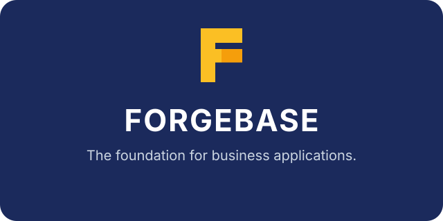
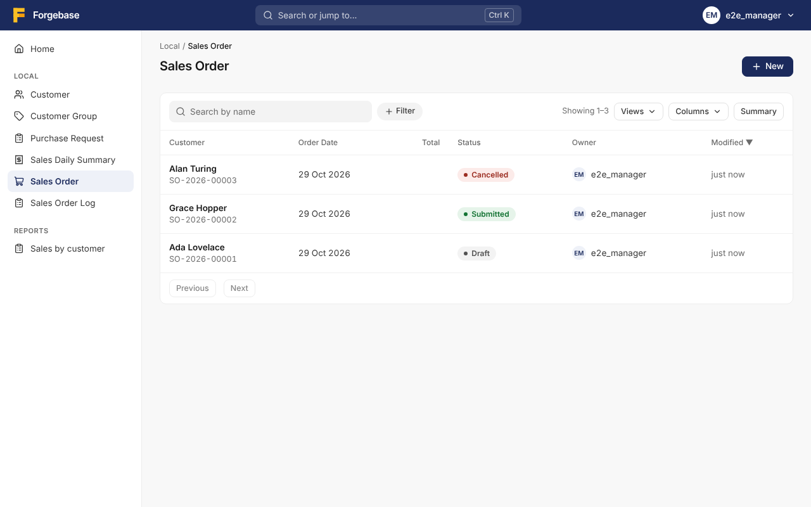

<p align="center"></p>

<p align="center"><strong>The foundation for business applications.</strong></p>

<p align="center">
  
  
  
</p>

# Forgebase

Forgebase is a Go framework for building business applications, inspired by the concepts and capabilities of the Frappe Framework. It is an independent implementation: no Frappe code is copied.

> Build for longevity, not complexity. Maintenance is the most expensive part of software ownership.

You describe a business entity (a customer, an order, an invoice) in a small TOML file, a **DocType**. Forgebase creates its PostgreSQL table, its REST API, its permission checks, its lifecycle (submit, cancel, amend, workflow) and a web desk with list and form views. Your own rules go in plain Go hooks. It ships as one binary and one built desk, runs on one PostgreSQL database per site, and is built for a low long-term maintenance cost: a modular monolith with few dependencies, and every decision recorded in an [ADR](docs/adr/README.md).

> **This repository is the Go port.** Forgebase was first written in Rust, up to milestone M10, at <https://github.com/tvstore/Forgebase>. That repository is **frozen and is the reference implementation** during the port: the Go version has identical behaviour (HTTP API, database schema, metadata formats, command line, configuration) and adds no features. The owner's reason: Go builds fast, which matters when a client needs a quick change ([ADR 0026](docs/adr/0026-go-implementation.md)).

<p align="center"></p>

## What it will do

The behaviour below is the behaviour of the Rust implementation, which the Go port reproduces phase by phase (see [Status](#status)). The guides describe it; their code examples still show the Rust API until the phase that ports them.

- **Metadata DocTypes**: fields, links, child tables, naming series and validation from one TOML file ([architecture](docs/blueprint/architecture.md#3-metadata-doctype-model-proposed)).
- **Document lifecycle and workflow**: insert, update, delete, submit, cancel and amend, optimistic concurrency, and approval workflows with states and role-checked transitions ([workflow guide](docs/guide/workflow-and-reports.md)).
- **Permissions**: roles with per-right grants, owner-only rules and query enforcement ([security model](docs/blueprint/security-model.md#authorization-implemented-in-m32-adr-0011)).
- **REST API**: sessions with CSRF protection, API tokens, filters, sorting and paging, stable error codes ([HTTP API](docs/guide/http-api.md)).
- **Desk**: a React web interface generated from the metadata, with saved views and a command bar ([desk guide](docs/guide/desk.md)). The desk is the same as in the Rust implementation; the Go server serves it.
- **Jobs and schedules**: a transactional job queue with retries and a scheduler ([jobs and schedules](docs/guide/cli.md#background-jobs)).
- **Multi-site**: several sites on one server, one database each, chosen by the Host header ([sites](docs/guide/cli.md#sites)).
- **Backups**: `site backup` and `site restore` with the PostgreSQL client tools ([operations guide](docs/guide/operations.md#backups)).
- **Reports**: SQL query reports that run by role in a read-only transaction ([reports](docs/guide/workflow-and-reports.md#3-query-reports)).
- **Apps**: your DocTypes, hooks, jobs and migrations in a Go module that imports the public API only ([first app](docs/guide/first-app.md)).
- **Webhooks**: signed JSON deliveries of document events to other systems, sent after the commit, with an SSRF guard ([webhooks guide](docs/guide/webhooks.md)).

## Status

The port has eight phases, then a parity report that compares the Go implementation with the Rust one. The plan was approved by the owner on 2026-11-06 ([owner decisions](docs/owner-decisions.md#go-port-2026-11-06-setuju-g1g8-information-session)).

| Phase | Scope (Rust milestone) | Status |
|---|---|---|
| P0 | Foundations: the Go module and package skeleton, CI (with `ci-result` failing on drafts), licence check, documentation, [ADR 0026](docs/adr/0026-go-implementation.md) | **In progress** |
| P1 | Metadata and storage (M1): P1.1, the metadata, validation and permission core (`internal/core`, `internal/decimal`), and P1.2, the database foundations (`internal/db`: the pool, the framework migrations and the schema sync), are implemented | **In progress** |
| P2 | Relationships and lifecycle (M2) | Planned |
| P3 | Auth, permissions and the REST API (M3), the minimal desk (M4) and UX, serving the unchanged desk | Planned |
| P4 | App model and developer experience (M5), the example apps, `forgebase/testing` | Planned |
| P5 | Jobs and scheduler (M6), sites (M7), PostgreSQL TLS (M9.0, moved from P7), container and deploy (D1, D2) | Planned |
| P6 | Workflow and reports (M8) | Planned |
| P7 | Integration (M9.1–M9.5) and customization (M10) | Planned |
| Parity report | The Go implementation against the Rust one; the owner then decides about archiving the Rust repository | Planned |

The milestones of the Rust implementation (M0 to M10) and their exit criteria are in [docs/blueprint/milestones.md](docs/blueprint/milestones.md); the full status is in [docs/README.md](docs/README.md#project-status).

## Quick start

Coming in **P3 and P4** (the `forgebase` command, then the example apps and the desk served by the Go server). Today the module builds and prints its version:

```sh
GOTOOLCHAIN=go1.27.3 go run ./cmd/forgebase --version     # forgebase 0.0.0
```

Until then, the quick start of the Rust implementation in the [getting started guide](docs/guide/getting-started.md) shows what the Go port will do.

## Documentation

All guides are indexed in [docs/README.md](docs/README.md). The main ones:

- [Getting started](docs/guide/getting-started.md), [Your first app](docs/guide/first-app.md) and [the command-line tool](docs/guide/cli.md)
- [HTTP API](docs/guide/http-api.md), [Desk](docs/guide/desk.md) and [Workflow, saved views and reports](docs/guide/workflow-and-reports.md)
- [Customizing and restricting data](docs/guide/customizing.md) (overlays, site custom fields, field permission levels, user permissions)
- [Webhooks](docs/guide/webhooks.md), [Integrating with other systems](docs/guide/integration.md), [Operating Forgebase](docs/guide/operations.md) and [Deploy](docs/guide/deploy.md)
- The blueprint: [vision](docs/blueprint/vision.md), [architecture](docs/blueprint/architecture.md), [security model](docs/blueprint/security-model.md), [dependency evaluation](docs/blueprint/dependency-evaluation.md) and the [ADRs](docs/adr/README.md), starting with [ADR 0026, the Go implementation](docs/adr/0026-go-implementation.md)

## Contributing

Read [CONTRIBUTING.md](CONTRIBUTING.md) for the local checks, and [AGENTS.md](AGENTS.md), which every contributor and agent must follow (the workflow, the engineering principles, git safety).

## License

MIT. See [LICENSE](LICENSE).
